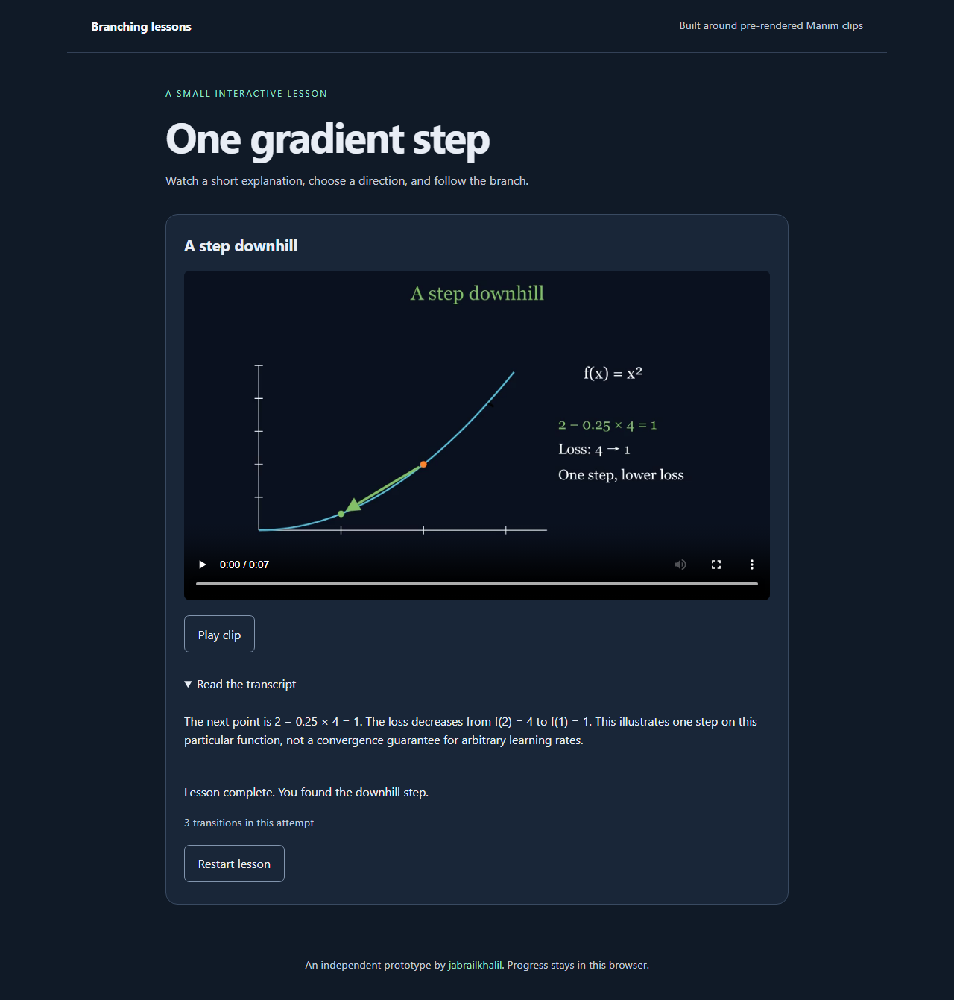

# Manim branching lessons

I built an independent player around pre-rendered Manim clips. The included
lesson asks for one gradient descent step on `f(x) = x²`. A correct answer leads
to the downhill scene; an incorrect answer leads to a correction and a retry.

I started this after [Manim discussion #5110](https://github.com/ManimCommunity/manim/discussions/5110).
This is an early companion prototype, with no upstream affiliation implied.

[Open the lesson](https://jabrailkhalil.github.io/manim-branching-lessons/).



## Run

```sh
npm ci
npm run build
npm run preview
```

Open the local URL printed by Vite. I include three actual Manim-rendered MP4s
and their source. There are no remote fonts, model calls or browser-side Python.
The clips are silent; each scene has a complete text transcript. Video playback
starts from an explicit button or the native controls.

I store the current attempt in this browser. Reloading resumes the branch.
Restart clears the attempt. I replay saved transitions against the manifest and
reset progress when its content fingerprint changes. Invalid stored data resets
to the beginning; denied storage leaves the lesson usable within the tab.
This is a self-study interaction, not an authenticated examination system.

After building, `dist/` can be downloaded and served by a local static HTTP server
without an internet connection. I do not implement a service-worker cache: the
hosted URL itself still needs connectivity to load assets.

## Lesson format

`public/lesson.json` declares version 1, the start node and three node kinds:

- `question`: a clip, transcript, prompt and explicit choice-to-node transitions.
- `explanation`: a clip, transcript and an explicit next node.
- `complete`: a clip and transcript that finish the attempt.

I validate unique IDs, local clip paths, targets, reachability and a path to
completion from every node. Correction loops are allowed. An attempt is bounded
to 200 transitions. I keep text literal in the DOM rather than interpreting
manifest text as HTML. This first UI loads the bundled manifest; it does not
provide a lesson authoring interface.

## Re-render the clips

```sh
python -m venv .venv-render
# Activate it, then:
python -m pip install -r render/requirements.txt
python -m manim -ql --resolution 960,540 --fps 15 --disable_caching \
  --media_dir media render/scenes.py Question Correction Success
python render/publish_clips.py
```

I use Manim 0.22.1 and text objects, so this example does not require LaTeX.
Manim's platform dependencies still apply. The publication script decodes every
frame, checks dimensions and timestamps, extracts posters, and records clip
hashes in `public/clips/render-info.json`. Fonts can produce different pixels
across platforms; I do not claim bit-for-bit reproducible video rendering.

## Checks

```sh
npm run check
npm test
npm run build
npx playwright install
npm run test:browser
```

I test both answer paths, reload/restart, content-version changes, malformed
graphs and saved data, stale actions, unavailable storage and literal rendering
of malicious-looking text. Browser tests use built assets, actual video playback,
keyboard interaction, a narrow viewport, blocked external requests and axe.
I have not conducted screen-reader user testing or a real classroom evaluation.
I have not implemented runtime rendering, arbitrary Python execution, a backend,
analytics or a grading service.
